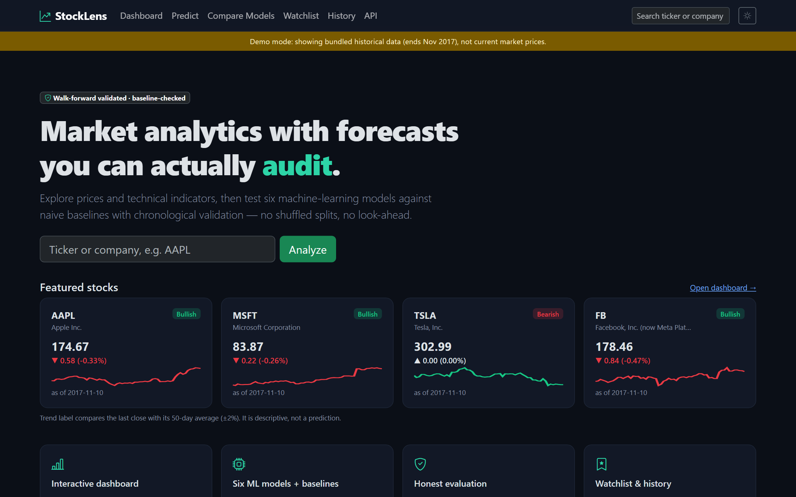
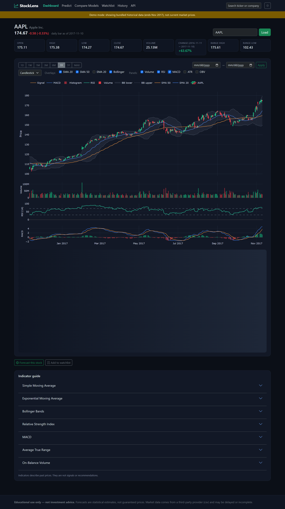
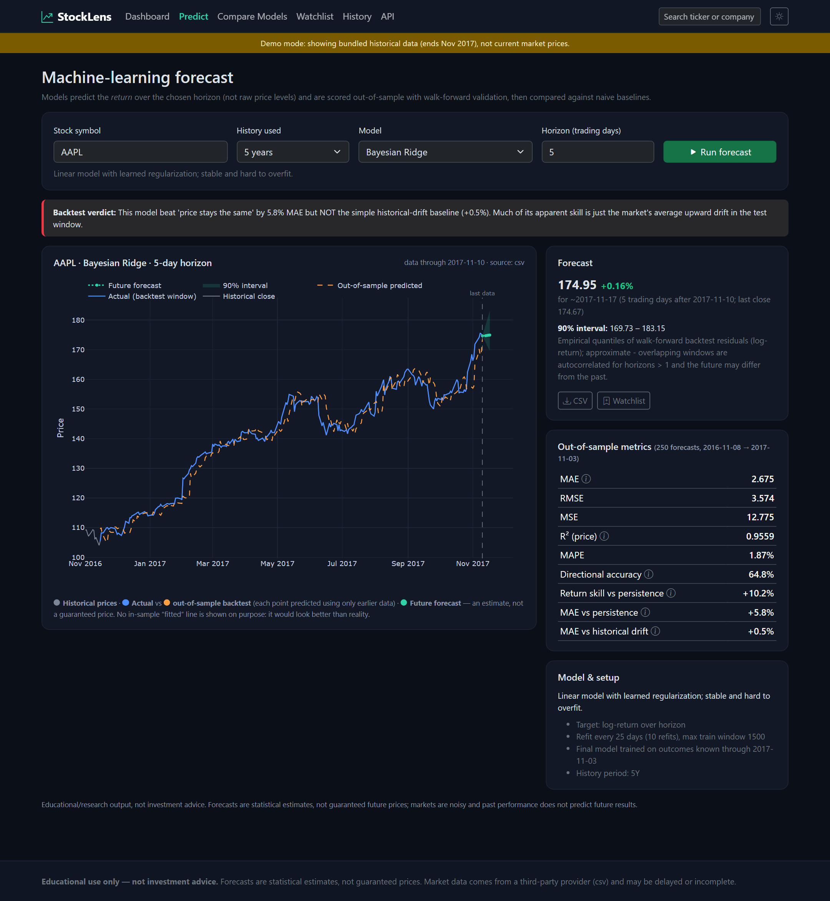
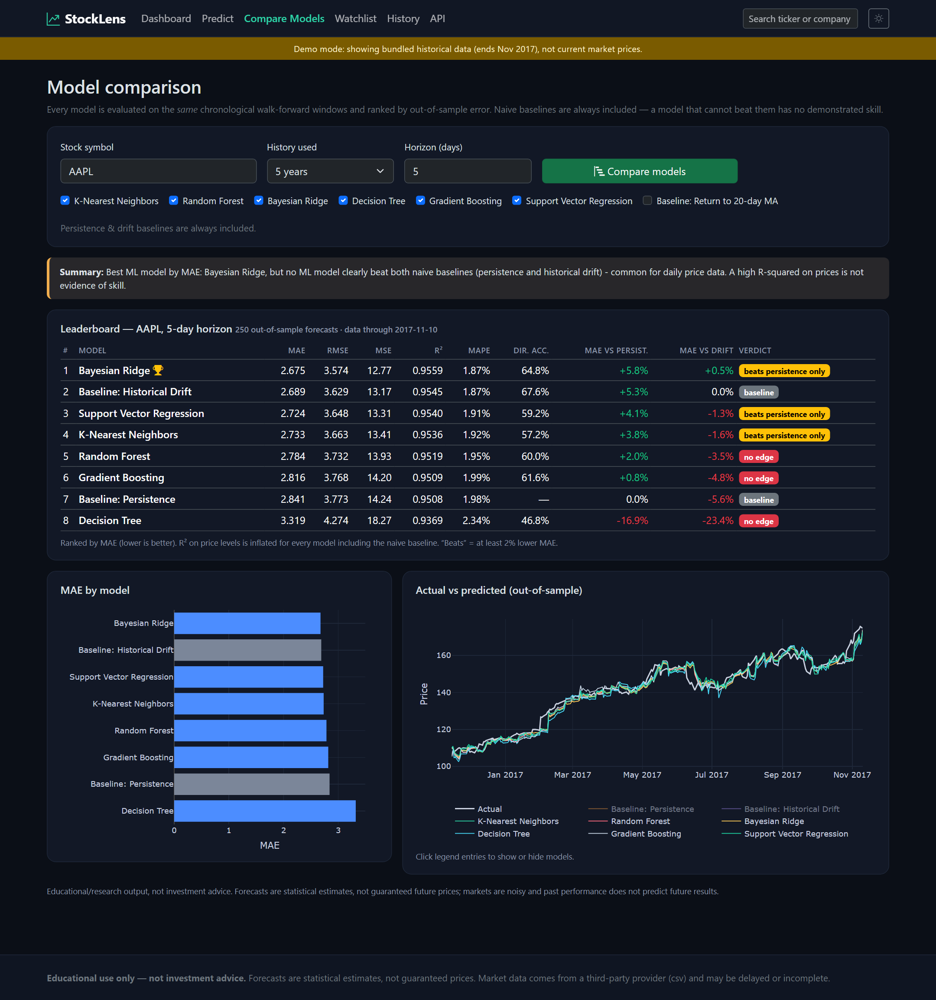
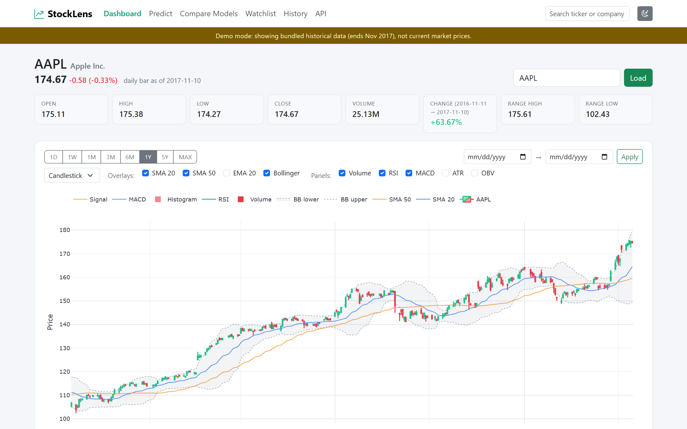
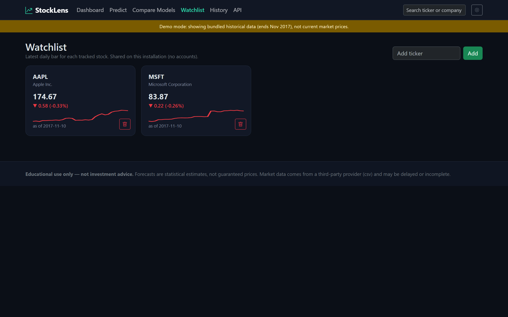

# StockLens — Stock Market Analytics & Forecasting Platform


A FastAPI + Plotly web application for exploring stock prices and technical indicators, and for **honestly** testing machine-learning forecasts:
chronological walk-forward validation, no look-ahead, and every model scored against naive baselines.

Evolved from the notebooks in [`mdhasanemam/stock-price-prediction`](https://github.com/mdhasanemam/stock-price-prediction) (see
[`docs/TECHNICAL_ASSESSMENT.md`](docs/TECHNICAL_ASSESSMENT.md) for what was wrong with the originals and what changed).

> **Educational use only — not investment advice.** Forecasts are statistical estimates, not guaranteed prices.

## Screenshots
<table>
  <tr>
    <td><br><sub><b>Home</b> — featured stocks and trend labels</sub></td>
    <td><br><sub><b>Dashboard</b> — candlesticks, overlays, RSI, MACD</sub></td>
  </tr>
  <tr>
    <td><br><sub><b>Forecast</b> — out-of-sample backtest vs future forecast</sub></td>
    <td><br><sub><b>Model comparison</b> — leaderboard vs naive baselines</sub></td>
  </tr>
  <tr>
    <td><br><sub><b>Light theme</b></sub></td>
    <td><br><sub><b>Watchlist</b></sub></td>
  </tr>
</table>

_Screenshots were captured with `scripts/capture_screenshots.py` (see below). If they show a "Demo mode" banner, they use the bundled 2017 sample data, not live prices._

## Features
| Area | What you get |
|---|---|
| Dashboard | Search by ticker/company, latest OHLC + volume + daily change, ranges 1D/1W/1M/3M/6M/1Y/5Y/Max + custom dates, candlestick/line charts |
| Technical analysis | SMA, EMA, RSI, MACD, Bollinger Bands, ATR, OBV — toggle overlays/panels, built-in indicator guide |
| Forecasting | Pick stock, history window, model, horizon (1–30 trading days). Shows historical prices, **out-of-sample backtest (actual vs predicted)** and the **future forecast** with an empirical interval when enough residuals exist |
| Model comparison | KNN, Random Forest, Bayesian Ridge, Decision Tree, Gradient Boosting, SVR + baselines on identical walk-forward windows; leaderboard with MAE, MSE, RMSE, R², MAPE, directional accuracy and "beats baselines?" |
| Watchlist & history | SQLite-backed watchlist; every prediction saved with config + metrics; CSV export |
| Engineering | Pluggable data providers, validation, disk+memory cache with stale-cache fallback, retries, rate limiting, CORS config, Swagger docs at `/docs`, dark/light theme, responsive layout |

## Quick start
```bash
python -m venv .venv && source .venv/bin/activate
pip install -r requirements-dev.txt
cp .env.example .env            # DATA_PROVIDER=yfinance (live) or csv (offline demo)
python -m uvicorn backend.app.main:app --reload     # http://localhost:8000
python -m pytest -q
```
**Windows (PowerShell):**
```powershell
python -m venv .venv; .venv\Scripts\Activate.ps1
python -m pip install -r requirements-dev.txt
copy .env.example .env
python -m uvicorn backend.app.main:app --reload
```
Offline demo without internet: `DATA_PROVIDER=csv` (bundled AAPL/FB/MSFT/TSLA daily data, ending 2017-11-10 — a banner reminds you it is not current).
Regenerate screenshots: `pip install playwright && python -m playwright install chromium`, start the app, then `python scripts/capture_screenshots.py`.
Docker: `docker compose up --build` (see [`docs/DEPLOYMENT.md`](docs/DEPLOYMENT.md)).

## How the ML is done (and why)
* **Target = h-day log-return**, not the raw price. Price forecast = last close × exp(predicted return). Price levels are non-stationary and let almost any model reach R² ≈ 0.95+.
* **Features** (19, `backend/ml/features.py`): lagged returns, rolling volatility, distance from SMA/EMA, RSI, MACD histogram, Bollinger %B, ATR%, volume z-score, intraday range, overnight gap. Everything at row *t* uses data up to the close of *t*.
* **Walk-forward evaluation** (`backend/ml/validation.py`): up to 250 out-of-sample decision dates; the model is refit every 25 days on a rolling window of ≤1500 rows. Training rows are *purged* so a target that ends after the decision date is never used. Scalers are inside each sklearn `Pipeline`, so they see training data only. Data is never shuffled.
* **Baselines**: *persistence* (price unchanged), *historical drift* (average return), *return to 20-day MA*. A model "has an edge" only if its MAE is >2% lower than **both** persistence and drift.
* **Metrics**: MAE, MSE, RMSE, R² and MAPE on price; directional accuracy; return-skill vs a zero forecast (OOS R²).
* **Intervals**: empirical quantiles of backtest residuals (90%), shown only with ≥60 residuals; approximate (overlapping windows are autocorrelated for h>1). Intermediate path points are a straight line in log-price to the direct h-day forecast — not separate model outputs.
* **Three kinds of output are kept visibly separate:** historical prices; out-of-sample backtest predictions; the future forecast. In-sample "fitted" lines are deliberately not drawn.

### What the benchmark actually shows
`scripts/benchmark.py` → [`docs/BENCHMARK.md`](docs/BENCHMARK.md) (5-day horizon, 10Y history, up to 250 out-of-sample forecasts per ticker, bundled 2017 sample data):

| Ticker | Models clearly beating both baselines | Best ML model by MAE |
|---|---|---|
| AAPL | Support Vector Regression, Random Forest (≈2.2% lower MAE than drift) | SVR |
| FB | none | Bayesian Ridge (0.4% better than drift) |
| MSFT | none (drift baseline ranked first) | Bayesian Ridge |
| TSLA | none (drift and persistence both outrank every ML model) | Random Forest |

Take-away: on daily data, most of the apparent "skill" is the market's average upward drift. Margins are small, ~250 points per test, no
significance testing — treat even the AAPL result as weak evidence. The platform is built to show you this rather than hide it.

## Security
No API keys are needed, and `.env`, databases and caches are git-ignored. The app validates all inputs, rate-limits requests, restricts CORS, sets security headers,
hides Swagger/OpenAPI when `ENVIRONMENT=production`, and runs as a non-root user in Docker. **There is no authentication** — the watchlist/history are shared,
so don't host a public instance for private use. Details and known gaps: [`SECURITY.md`](SECURITY.md).

## Project layout
```
backend/app/   FastAPI app: api/ (routes), core/ (config, errors), schemas/, services/ (providers, data, indicators, prediction), database/
backend/ml/    features, models (registry + baselines), validation (walk-forward), forecasting, metrics
frontend/      Jinja templates + static JS/CSS (Bootstrap 5, Plotly) — no build step
tests/         pytest suite     scripts/  benchmark, dev run, publish     docs/  assessment, benchmark, deployment
data/sample/   bundled historical CSVs from the original project (see note below)
```

## API (see `/docs` for Swagger — available except when `ENVIRONMENT=production`)
`GET /api/stocks/search · /{symbol}/quote · /{symbol}/history · /{symbol}/indicators` · `GET /api/models` · `POST /api/predict` · `POST /api/compare` ·
`GET|POST|DELETE /api/watchlist` · `GET|DELETE /api/history` · `GET /api/history/{id}/export.csv` · `GET /api/overview` · `GET /api/health`

## Testing status — what was and wasn't verified
Verified in development (Linux sandbox, Python 3.12, `DATA_PROVIDER=csv`):
* **37 automated tests pass** (indicators incl. no-look-ahead; security headers/secret hygiene; feature leakage; walk-forward chronology/purging; "future data cannot change past predictions"; data validation & stale-cache; every API endpoint, error code, watchlist/history CRUD, rate limit, page rendering).
  Two deliberate *mutation checks* (removing the purge; leaking a future value into a feature) made the leakage tests fail, as they should.
* The real frontend JavaScript was executed in jsdom against a live server (25 behavioural checks: home, dashboard overlays/panels/custom range, predict, compare, watchlist, history). Plotly/Bootstrap were stubbed.

**Not verified:** live Yahoo Finance data (no internet in the sandbox — the yfinance provider is written defensively but untested against the live service); visual appearance in a real browser (no screenshots are included — add your own); the Docker image build; GitHub Actions; any cloud deployment.

## Known limitations / roadmap
No user accounts (watchlist/history are shared per installation) · no hyper-parameter search (fixed conservative settings) · exchange holidays not modelled in forecast dates ·
no LSTM/GRU/Prophet/XGBoost/ARIMA/SHAP — not added because nothing here shows they would beat the baselines · single-process cache and rate limiter ·
only yfinance and CSV providers implemented (Alpha Vantage / FMP are straightforward to add via `DataProvider`) · no significance tests (e.g. Diebold–Mariano) on model differences.

## Data & license
Code: MIT. `data/sample/*.csv` are the four-ticker datasets from the original repository (originally from a public Kaggle stock dataset); confirm their license before redistributing.
Live data comes from Yahoo Finance via `yfinance`, an unofficial interface subject to Yahoo's terms — fine for personal/educational use, not a licensed market-data feed.
